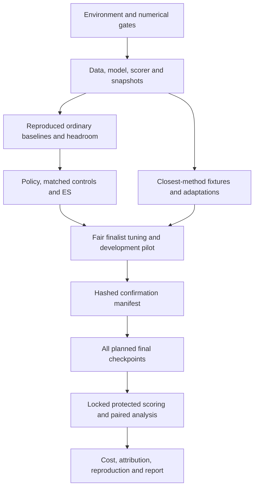

# RALUP research proof-of-concept specification

**Date / research cutoff:** 3 October 2026.

**Status:** specification for review; no implementation or experimental result is claimed.

**Source:** the user-supplied “Learning representation-aware update policies” research brief, including its reference ledger and prototype caveats. The literature statements below are inherited from that brief, not independently reverified during this documentation task.

**Implementation plan:** [plan and staged execution order](../plans/2026-10-03-ralup.md).

## 1. Intent, scope, and decision

Build a reproducible, locally executable research system to determine whether a small future-loss-trained update policy can improve quantized byte-Transformer continuation on an actual MacBook M3 Max. Its first beneficiary is the researcher running and auditing the experiment. RALUP is a project label, not a new calculus or a replacement for backpropagation.

The core question is whether tensor history and shadow-weight positions inside quantization cells improve update selection beyond strong ordinary optimizers, quantization-aware methods, and an equally informed learned learning-rate controller. Ordinary differentiation supplies inner gradients; actual short rollouts supply the outer objective. Deployment freezes the learned controller.

The selected architecture is PyTorch FP32 on MPS, with explicit E2M1 forward values, persistent FP32 shadows/state, and CPU float64 numerical oracles. This measures learning with a discretized forward representation. It does not demonstrate native FP4 throughput, master-weight-free memory savings, large-model generalization, or a new derivative.

Three approaches were considered:

| Approach | Benefit | Limitation / decision |
|---|---|---|
| Gated research package with common data/model/scorer and optimizer adapters | Auditable comparisons; intermediate deliverables remain useful after negative results | Selected; more infrastructure than a notebook, justified by leakage/state/fairness risks |
| One monolithic experiment notebook | Fast initial toy examples | Insufficient isolation of scoring, state, and selection; use only disposable diagnostic notebooks |
| Native low-bit Metal implementation first | Potential hardware efficiency | Defers the scientific question behind kernel work; outside the initial program |

The realistic core is warm-started quantization-aware continuation of the 3,347,456-parameter model. The 493,056-parameter proxy establishes correctness and meta-training signal. From-scratch training, 19,281,920 parameters, activation quantization, FP8, and MXFP4 are gated extensions. No percentage improvement or laptop runtime is presumed.

## 2. Claims and non-negotiable evaluation contract

Requirement IDs in this document are stable traceability labels.

**S01 — Primary claim.** Conditional on one frozen controller, corpus, model, representation, and continuation budget, final quantized-model test bits per byte (BPB) must improve against both the strongest development-selected local competitor B* and the matched learned-LR controller. The wrapped ordinary backbone B0 can differ from B*.

**S02 — Statistical unit.** A fresh complete target-training seed is one independent unit. All three arms share that seed's warm start and target-block schedule. Tokens, timing repetitions, evaluation chunks, and downstream runs sharing one meta-trained controller are not independent meta-training replications.

**S03 — Endpoint and inference.** Score the exact final checkpoint at the frozen continuation-byte budget. BPB is total scored raw-byte NLL divided by `log(2) * scored_bytes`. Let delta be candidate BPB minus comparator BPB. For each of the two comparisons report `mean(delta) ± t(n-1, .9875)*sd(delta)/sqrt(n)`: two-sided 97.5% paired intervals, conservative simultaneous coverage at least 95%. H1+H2 requires both upper bounds below zero. Report per-seed outcomes, absolute BPB, differences, and byte-perplexity ratio `2**mean(delta)`; transform interval endpoints for ratio uncertainty. Do not substitute Holm testing or a best-test-checkpoint endpoint.

**S04 — Interpretation.** H1 is final quality versus B*; H2 is incremental value versus matched learned LR. Mixing geometry (H3), new shapes/seeds (H4), and end-to-end value (H5) need their own declared tests. One frozen-policy result does not establish reliability of the meta-training recipe. A tightly estimated negative finding is a valid outcome; a wide interval is inconclusive.

**S05 — Cost and failures.** Maintain three ledgers: optimizer-stream bytes/updates; every additional query/gradient/Hessian pass and processed target; complete project/deployment elapsed time. Include the common warm start. Report synchronized throughput, time to a development-defined target, RSS and MPS counters separately, export bytes, tuning/meta costs, and divergence rates. Additional-pass methods also receive comparisons at matched total processed targets and wall time. Finite-budget divergence is a substantive failure, never silently replaced. Infrastructure bugs invalidate all affected runs with versioned reruns and retained originals. Successful-run-only intervals cannot establish an all-run BPB claim when divergence occurs; also report an ordinal sensitivity analysis with divergence ranked worse than finite completion.

**S06 — Protected outcomes.** Official validation is development; official test stays protected until the locked manifest and all planned final checkpoints exist. No test score enters normalization, baseline ranking, controller training, early stopping, or sample-size selection. Changes after protected inspection are exploratory and need fresh independent confirmation for a revised claim; repeated use of a public corpus remains a limitation.

## 3. Components and ownership

Use one package, `ralup`, rooted at `src/ralup/` in this repository; do not create a redundant nested repository. Components have the following ownership:

| Component | Responsibility | Depends on |
|---|---|---|
| `config.py`, `records.py`, `environment.py` | Validated immutable configuration, hashes, evidence, hardware/operation probes | Standard library; installed numerical stack for probes |
| `quantization/` | Exact formats, scales, transforms, surrogate graphs, export codecs | Tensor API; float64 oracle |
| `data/` | Source rows, articles, deduplication, partitions, target blocks, resumable cursors | Pinned source assets |
| `models/` | Specified byte Transformer and quantized linear layers | Quantization contexts |
| `optim/` | Ordinary update proposals and method-specific state ordering | Accumulated clipped gradients |
| `baselines/` | Original-format fixtures and named adaptations | Common training/model/quantizer interfaces |
| `policy/` | Features/history, bounded actions, candidate/static/LR controllers | Base proposal and cached context |
| `state.py`, `train.py`, `evaluate.py` | Complete logical-step transaction, snapshots, common scoring | Data, model, update adapters |
| `meta/` | Full-state task sampling, antithetic ES, selection artifacts | Rollout engine |
| `calibrate.py`, `search.py`, `runner.py` | Measured capacity, fair tournament, locked jobs | Common engine and ledgers |
| `analysis/`, `report.py`, `export.py` | Planning/inference, traceable reports, actual packed model | Immutable artifacts |

**S07 — Interface boundaries.** A `QuantizationContext` owns detached numerical scales/codes, rotation/grouping/backward identifiers, logical-step ID, and scale metadata. `BaseUpdateRule.propose` returns a `Proposal(reference_after_decay, gradient_displacement, new_optimizer_state)` without modifying parameters or old state. A `MethodAdapter` owns any exceptional priming, extra passes, or history needed by methods such as QAR/MetaQuant; it cannot change the shared scorer or stream schedule. A `TrainingSnapshot` contains every mutable state item listed in §9. Tensor names and ordering are explicit manifests, not iteration accidents.

## 4. Data and model contract

**S08 — Provenance.** Use `Salesforce/wikitext`, `wikitext-103-raw-v1`, at an exact revision and asset SHA-256 hashes. Download Parquet/text without remote executable dataset code. Record the supplied card's CC BY-SA 3.0/GFDL texts, attribution, actual expanded/download sizes, and reuse decisions before execution. No gated model or paid service is required.

**S09 — Articles and deduplication.** Preserve source order and original Unicode/UTF-8. Each row contributes unchanged UTF-8 bytes plus one LF only when absent; an empty row contributes LF. A top-level heading has whitespace tokens whose first and last are exactly `=`, at least one interior token, and no additional standalone `=` token. Thus `= Title =` is a heading; `= = Section = =` and `== Section ==` are not. Preserve preamble as its own identified document and store original rows, byte offsets, source row ranges, and reconstruction hashes so the transformation is reversible.

Collapse exact duplicate training articles to a canonical copy, remove training articles overlapping validation/test, and leave protected documents intact. For the near-duplicate audit use only NFKC/lowercase/whitespace normalization, 13-token shingles, 128 explicitly seeded MinHash functions, 16 bands of 8, and exact shingle Jaccard verification at threshold .8. A shorter document contributes its complete token tuple as one shingle. Fix stable hash definitions/seeds in the data manifest; never use process-randomized Python hashes. Keep the lexicographically smallest raw-content hash of each connected training component, and discard entire training components connected to any protected document. Exact checks and near-duplicate exclusions precede final partitioning. Report LSH miss risk; do not claim complete absence of public-data contamination.

Partition retained official-training articles by the first 64 bits, big-endian, of `SHA256(b"ralup-split-v1" + article_bytes)`, divided by `2**64`: meta-train `[0,.20)`, meta-development `[.20,.25)`, target-training `[.25,1)`. Use integer/rational comparisons at thresholds. Record actual documents and bytes. Amend inadequate allocations before modeling/protected outcomes and invalidate dependent artifacts.

**S10 — Byte scoring.** Vocabulary is 257: raw bytes `0..255` and input-only boundary token `256`. Logits normalize over all 257. No EOS target. Context length 256; target blocks contain at most 128 bytes. At article offset zero prepend token 256; otherwise prepend up to 128 immediately preceding bytes from the same article. For `sequence = context + target_bytes`, input is `sequence[:-1]`, labels are `sequence[1:]`, and only labels corresponding to the declared target interval are scored. Pad/mask correctly. Score each raw byte exactly once; do not concatenate articles. Position IDs restart at zero for each constructed block.

Training shuffles these same blocks with a named seed without replacement within an epoch. Logical batch initially contains exactly 8,192 scored bytes. Split a final block's *loss-mask interval* when necessary and carry its unconsumed interval forward, preserving that block's original input/context/position IDs. Physical microbatch packing cannot alter this logical schedule. The final finite-budget batch may contain fewer targets, explicitly recorded. Backpropagate summed NLL across microbatches, divide gradients once by total selected targets, then clip once. Report repeated and unique targets separately. A mean of unequal microbatch means is invalid.

**S11 — Transformer.** Causal decoder, pre-LayerNorm, GELU, MLP ratio 4, no dropout, no linear biases, learned absolute positions of length 256, separate Q/K/V/attention-output/up/down matrices, untied token embedding and output head, final LayerNorm. LayerNorm gain/bias exist. Use explicit masked reference attention before an optimized path passes loss/gradient parity. Pin LayerNorm epsilon `1e-5` and exact GELU (`approximate="none"`) as engineering resolutions of unspecified framework defaults. Initialize matrices/embeddings/positions with normal std .02, except attention-output/MLP-down std `.02/sqrt(2*layers)`; gains one, biases zero.

| Role | Layers / width / heads | Total parameters | Quantized internal parameters |
|---|---|---:|---:|
| Proxy | 2 / 128 / 4 | 493,056 | 393,216 |
| Core | 4 / 256 / 4 | 3,347,456 | 3,145,728 |
| Escalation | 6 / 512 / 8 | 19,281,920 | 18,874,368 |

Formula: `12*L*D**2 + 4*L*D + 2*D + 2*257*D + 256*D`. A count discrepancy blocks training until explained.

**S12 — Warm starts.** Train meta warm starts on meta-train and target warm starts on target-training. Clone paired arms bit for bit and reset continuation optimizer state. Carry-state experiments are separate. Choose warm-start and continuation lengths using development budget doublings: learning must remain, quantization damage must be measurable, and later ranks must be assessed. If ranks continue changing, extend or label the resource-limited horizon. Never choose a protected-score-favorable duration.

## 5. Representation and logical-step semantics

**S13 — E2M1.** Unique numerical levels are `[-6,-4,-3,-2,-1.5,-1,-.5,0,.5,1,1.5,2,3,4,6]`. Canonicalize zero positive, round nearest with ties to even least-significant significand bit, saturate finite overflows, and reject NaN/Inf. Maintain explicit encoding parity; numerical sorted index parity is not the encoding tie rule. CPU float64 oracle compares all 15 distances. Production tensor quantization uses thresholds/comparisons or a verified bucketize implementation without a parameter-by-codebook allocation or per-step CPU copies.

For row-major W and orthonormal identity/Hadamard R, `U=W@R` and linear output is `(X@R)@Q(U).T`. Butterfly normalization is `1/sqrt(input_width)`. Quantize internal projections only; all other parameters, arithmetic, gradients, shadows and optimizer state remain FP32. This is simulated FP4 W4A32, not automatically MXFP4.

**S14 — Recipes.** `row_fixed_max` initializes each row scale `max(abs(U))/6` from its warm start and freezes it; zero rows use one and are counted. `row_dynamic_max` recomputes once at the beginning of a logical step; evaluation recomputes once for final weights. Both detach scales. `quest_fp4_row_reference` uses per-row weights, identity/Hadamard, deterministic Gaussian-fit scale, and trust backward. Whole-tensor grouping is a sensitivity arm. Per-token activation grouping is specified only for a later activation-quantized branch. Label grouping explicitly; release reproduction requires upstream grouping parity.

For QuEST fitting, candidate normalized levels are `q_i=a*C_i/6`, midpoint bounds `l,u`, and normal moments are `M0=Phi(u)-Phi(l)`, `M1=varphi(l)-varphi(u)`, `M2=M0+l*varphi(l)-u*varphi(u)` with infinite products zero. Minimize `sum(M2-2*q*M1+q*q*M0)` with deterministic bracketed search in log(a), expanding/checking the bracket. Store a, objective, integration conventions/residual; scale is `a*RMS(group)/6` and trust threshold is s. All-zero groups return zeros with a positive sentinel scale and explicit flag. Plain STE returns incoming gradient; trust masks errors above s; clipped STE is a separately named variant. Backward must invert the rotation.

**S15 — Cache lifecycle.** At each logical-step start cache detached scales and exact forward codes. Stochastic weight rounding draws one realization shared by all physical microbatches. Construct a fresh surrogate graph for each backward; do not retain a microbatch graph. Evaluation neither advances history nor consumes training RNG streams. Moments remain in original W coordinates. Storage-space modifications map back with R transpose; rotated moments would define another optimizer.

Logical-step order is normative:

1. Prepare contexts for actual pre-step weights and obtain the immutable logical batch.
2. Accumulate summed target NLL/backward; divide gradients once; clip once if selected.
3. Update each base optimizer's moments exactly once and obtain its uncommitted proposal.
4. Map decay reference/displacement to U; collect features from the proposal, old histories and current training loss.
5. Apply controller, multiplicative/additive mixture and boundary assistance; commit in place under no-grad, preserving Parameter identity.
6. Update auxiliary parameters using their declared adapter; compute cached-scale transition telemetry and commit loss/history state once.
7. At the next step's context preparation resolve realized-versus-cached history under the refreshed scale; expose it before that step's feature collection. Final diagnostics may prepare a read-only final context. Advance scheduler/cursor/ledgers only for a completed transaction.

**S16 — Proposal contract.** AdamW uses `m=beta1*m+(1-beta1)*g`, `v=beta2*v+(1-beta2)*g*g`, bias-corrected `dW=-lr*mhat/(sqrt(vhat)+eps)`, and `W0=(1-lr*decay)*W`. Other optimizers preserve their own ordering, bias correction, and initialization; adapters must reproduce upstream bypass behavior. No default decay on normalization, embeddings or output head. Initial AdamW probe: LR .001, betas (.9,.99), epsilon 1e-8, decay zero; tune in the actual quantized setting.

## 6. Policy mathematics and information contract

**S17 — Geometry.** Let `U0=W0@R`, `dA=dW@R`, `r=RMS(U0)`, `a=sign(U0)*dA/max(r,1e-30)`, `z=U0*a`, and `c=RMS(dA)/RMS(z)` if `RMS(z)>0`, else zero. Define `dM=U0*expm1(clip(c*a,-.1,.1))` and `d=h*((1-alpha)*dA+alpha*dM)`. Never normalize dM after exponentiation. Multiplication preserves individual signs/zeros; the additive branch escapes zero and the blend may cross it. This proposal is not Madam. Positive finite-q perturbation is exponential reparameterization; no separate q action exists. Retain only a cheap quadratic finite-q diagnostic. An EMA is not fractional calculus.

**S18 — Assistance.** Use cached scales. Compute `q0=Q(U0)`, `y=U0+d`, `q1=Q(y)`, directional neighboring level qn, midpoint b, `rho=abs(b-U0)`, and `gap=abs(qn-q0)`. Feasibility requires nonzero d, U0 within finite bounds, an existing directional neighbor. Eligibility additionally requires `q1==q0`, `rho>0`, `abs(d)>=tau*rho`. At tau exactly one bypass assistance. Otherwise propose `candidate=b+sign(d)*min(gap/1024,abs(d)/1024)` and accept only when `Q(candidate)==qn`, bounds hold, and `abs(candidate-U0)<=(1/tau+1/1024)*abs(d)` within declared dtype tolerance. Reject unrepresentable FP32 nudges, retain y, and count rejection; do not enlarge margins. Publish the tolerance with oracle/MPS probes before neural runs and record observed bound excess. No norm rescaling or reset to a code center after assistance. Common decay is already in U0 and must never be amplified as part of d.

At `(alpha,h,tau)=(0,1,1)` use an explicit bypass to the original-coordinate base commit so identity rotation is bitwise identical, avoiding needless add/multiply/copy-order changes. Rotated non-bypass paths have a measured roundoff contract. The frozen initialized controller must reproduce B0; special-casing identity actions is allowed and tested.

**S19 — Shared controller.** One affine map from 14 scalars plus intercept to three outputs: exactly 45 learned parameters, no matrix ID. Weights zero, biases `(0,0,1)`. Map outputs `(a,b,c)` to `alpha=clip(a,0,1)`, `h=exp(clip(b,log(.25),log(4)))`, `tau=clip(c,.125,1)`. Hard clips are intentional for ES.

| # | Feature before parameter commit |
|---:|---|
| 1 | `log10(max(RMS(U0),1e-30))` |
| 2 | `log10(max(RMS(gW),1e-30))` |
| 3 | `log10(max(RMS(dA)/max(RMS(U0),1e-30),1e-30))` |
| 4 | Cosine of gW and newly updated first moment in W coordinates; zero if denominator zero |
| 5 | Fraction of nonzero additive moves retaining cached-scale codes |
| 6 | Mean `min(abs(dA)/max(rho,1e-30),2)/2` over feasible positive-distance coordinates |
| 7 | Fraction of those coordinates with `rho/gap <= .1` |
| 8 | Fraction of U0 outside finite scaled range |
| 9 | Previous fixed-scale transition fraction |
| 10 | Previous reversal fraction on scale-compatible coordinates |
| 11 | Previous realized/cached code disagreement fraction |
| 12 | Prospective relative loss-EMA change, clipped [-1,1] |
| 13 | Intended full-continuation progress, clipped [0,1], never local k/K |
| 14 | `log2(output_dimension/input_dimension)` |

Empty populations return zero and log coverage. Features 5–7 use U0/dA, independent of selected actions. Loss EMA decay .95, first observation initializes it; feature 12 uses `(new-old)/max(abs(old),1e-6)` and commits once. Use zero for unavailable history and log a validity flag separately, without adding policy inputs. SOAP exposes the first moment mapped back to W; absent a comparable moment, charge a common gradient EMA equally to all controls.

Fit feature mean/std only on meta-train reference trajectories; freeze, divide by `max(std,1e-6)`, clip standardized values [-5,5], and report clipping on target runs. Normalize no protected data. Record previous two code arrays as bytes where possible, with scales. Reversal is `current==two_steps_ago != previous` only on matching scales; log eligible coverage. Transition diagnostics distinguish actual pre-step weights, decay-only reference, gradient-driven changes, cached predictions, refreshed realizations, and numerical endpoint displacement; code equality can hide moving scales.

**S20 — Matched controls.** Learned LR sees all 14 features/history/meta-data and rollout opportunities; network `14→3→1`, tanh hidden, 49 trainable parameters, zero final layer, `h=exp(clip(output,log(.25),log(32)))`. Independently tune backbone LR; add a shared-range sensitivity. Static control learns three constants with the same future-loss objective. Include candidate initialization, additive-only, multiplicative-only, assistance-only, retrained history/cell-feature removals, and a norm-matched additive attribution diagnostic with explicitly disclosed oracle access to candidate RMS.

**S21 — Outer objective.** With disjoint meta-train inner/query documents, optimize `J=(query_loss_final-query_loss_initial)/max(query_loss_initial,1e-6)` on the quantized forward. Initial/final query evaluations use the same declared query list and evaluation randomness; queries do not mutate training history. Include an unnormalized development sensitivity. Antithetic ES uses `g=sum((Jplus-Jminus)*epsilon)/(2*m*sigma)` with cloned complete state and matched inner/query/RNG inputs. Outer Adam has no decay; initial probes K=16, m=4, sigma=.05, LR=.01, betas(.9,.999), epsilon1e-8. No unrolled graph survives a step.

Calibrate repeated-rollout noise, paired perturbation signal, query size, m and sigma; compare K/2K/4K rankings and full continuations. Snapshots mix early/middle/late meta-train baseline states with refreshed policy-origin states; freeze proportions and sampling before final meta-training. Select on meta-development terminal loss then official-development full continuation, charging both selection stages. Proxy-trained deployment is default; valid in-proxy behavior but failed core transfer permits a separately labeled same-core-architecture meta-training branch. The deployed policy never receives query or protected outcomes.

## 7. Baseline fidelity and fair selection

**S22 — Method registry.** Every method records family, exact source revision, adaptation label, required operations, ordered parameter groups, state schema, licenses, and parity status. Distinguish original-format fixtures, paper references, and FP4/LM adapters in names and reports. A licensing/operation/parity block is not a defeated baseline. No copied restricted source without an explicit permitted reuse decision.

**S23 — Ordinary geometry.** Implement and test these contracts before claiming competitiveness:

| Method | Required update/fidelity contract |
|---|---|
| AdamW | S16; compare chosen installed `torch.optim.AdamW` scalar-loop settings on fixed gradient sequences, including decay, bias correction, epsilon and zero gradients |
| Muon project reference | `M=.95*M+G`; Nesterov input `G+.95*M`; transpose for rows≤columns, normalize Frobenius norm plus 1e-7, five iterations `A=X@X.T; X=3.4445*X-4.775*A@X+2.0315*A@A@X`; transpose back; rectangular multiplier `sqrt(max(1,rows/cols))`; independent LR and auxiliary AdamW |
| Muon+ paper reference | `M=mu*M+(1-mu)*G`, initial mu=.95; orthogonalize M; row, column, row→column or column→row normalization, each divides by `sqrt(sum(O**2,axis)+1e-8)`; displacement `-lr*sqrt(rows/cols)*O`; compare normalization on/off with identical momentum conventions |
| SOAP | Pin/reuse MIT implementation preserving initial eigendecomposition, later QR, basis-change moment handling, first-step initialization, bias correction and decay order. Screen refresh 1,4,10 and extend at an edge. Explicitly timed CPU factorization/transfers are a permitted faithful fallback |
| Madam | Fixed initial bound `3*RMS(Winitial)`; `v=.999*v+.001*g*g`, bias-correct and normalize gradient, define 0/0 as zero, clip [-10,10]; `W*=exp(-lr*sign(W)*normalized_gradient)` then clip to bound; initial LR .01, separately tune; preserve sign/zero restrictions |

**S24 — Quantization-aware comparators.** Implement the named fixture before assessing its adaptation:

| Method | Original fixture and declared adaptation |
|---|---|
| EWGS | Original normalized uniform backward `g*(1+delta*sign(g)*(xn-xq))`. FP4 adapter uses `z=clip(U/(6*s),-1,1)`, `q=Q(U)/(6*s)`, physical gradient times `1+delta*sign(g)*(z-q)` and declared clipping mask. Screen fixed delta; adaptive delta is `max(0,(trace(H)/N)/(3*std_population(g)+1e-12))` from Rademacher HVPs on a detached quantized leaf; specify probes/cadence and charge passes |
| TRS | Release fixture preserves fixed weight scales, coupled Adam decay, initial r=1 and K=target_rate, first effective LR alpha; subsequently `K=mu*K+(1-mu)*k`, `r=mu*r+(1-mu)*r*R_t/(K+1e-8)`, effective LR alpha*r, initial mu=.99. `trs_backbone_adapter` applies feedback to gradient displacement with separate decay and declares its chosen scale recipe. Count normalized quantized changes once per logical training step, prior codes initially zero, ignore first observed rate, evaluation read-only. Tune target schedules/alpha; preserve code-versus-paper discrepancy |
| QuEST | S14: identity/Hadamard crossed with STE/trust under matching forward; row/tensor grouping sensitivity. A portable mathematical reference is required even without CUDA; upstream grouping parity controls release-reproduction wording |
| QAR | Fixed uniform fixture: a=abs(u), b=a**gamma/mean(a**gamma); gamma=0 gives b=1 including zeros; p=min(eta*a*b/gap,1); Bernoulli one-code move in -sign(u). Endpoint state plus moments, no shadow residual. All-zero group or absent neighbor gives p=0. `qar_fp4_adjacent` replaces uniform gap with actual directional gap, retains one-neighbor move; tune gamma/LR and report clipping |
| Stochastic rounding | Between l≤x≤u choose u with probability `(x-l)/(u-l)`, exact levels deterministic, finite overflow saturated. Separate persistent-shadow forward noise from endpoint-only control. Final primary inference deterministic; stochastic expectation is secondary with uncertainty/cost |
| LSQ / learned FP4 scale | Uniform original fixture; FP4 `y=s*C_round(w/s)`, STE scale derivative `C_round(w/s)-w/s` in range, saturated code outside; multiply by `1/sqrt(N*Cmax)`, optimize log(s) with chain rule, tune scale LR separately. Equal scale information/export precision across matching arms |
| Damping / masking | Damping adaptation adds `lambda/2*||W-stopgrad(Q(W))||²`. Simple matrix masking updates moments always, commits displacement with probability .5 and doubles accepted moves. Magma-style adapter starts alignment .5, updates `.9*s+.1*sigmoid(cos(moment,gradient)/temperature)`, multiplies displacement by s*Bernoulli(.5) without doubling; tune temperature/LR and disclose source deviations |

**S25 — MetaQuant-LM.** Preserve an original uniform/DoReFa learning-mechanism fixture before `metaquant_lm_fp4`. Keep a scalar-input shared meta-network and previous quantizer-input gradient gprev and refined direction rprev. Initial no-activation option has bias-free widths 1,100,100,1; preserve all trainable factors/framework initialization even when multiplying factors to avoid parameter-count-by-width activations. Test values and factor gradients against the unfused version. A nonlinear option is a separate development configuration.

In storage coordinates normalize network input by cached row range, use physical identity-STE calibration, and compute `cU=f_theta(normalized_U)*stopgrad(gprev_U)`. The fast value is `Ufast=U-eta*(cU+stopgrad(rprev_U-cU))`; map to W with R transpose. Its numeric value follows rprev, while theta differentiation flows through cU. On the next training batch backpropagate the quantized loss, capture quantizer-input gradients, update theta, and commit base optimization using the **pre-theta-update** cW. The first batch primes history without selected-matrix update. Auxiliary fast/committed updates and decay are explicit settings. Initial meta Adam LR .001; tune. Freeze after meta-train/meta-development for the matched arm; an online target-training-only theta variant is separately labeled. Extra/priming passes enter all ledgers. No test-selected epoch convention is copied from upstream.

**S26 — Selection.** Use a risk-ordered tournament. First reproduce AdamW and at least one strong matrix optimizer, then select B0 among ordinary geometry and quantizer recipes using development headroom. Independently select B* from the full competitive pool, including closest methods and strong simple controls. Equal initial synchronized search-compute and development information per family; extend when curves are unsettled, uncertainty overlaps the leader, a scale-dependent mechanism is missing, or the optimum is at a search edge. A short proxy loss alone does not eliminate such a contender.

Bracket LR from source defaults and log multipliers until both under-updating and instability are found; refine. Initial Adam-like beta probes (.9,.95), (.9,.99), (.95,.999); tune decay/clipping/schedules when pilot sensitivity warrants it. Include zero/nonzero decay and constant/cosine/warmup-stable-decay candidates. Tune all effective step-size parameters in the quantized setting. Give compatible rotations/scales/kernel improvements to competitors and retain shared-recipe controls. Full-budget fresh development seeds decide finalists; B* is lowest mean final development BPB with exact ties resolved by lower end-to-end cost. If statistically indistinguishable alternatives remain, default to the single preselected B* and explicitly limit that claim. Include an ordinary baseline augmented with equivalent offline training data and compute.

## 8. Hardware, numerical acceptance, and budget resolution

**S27 — Environment gate.** Record `uname -m`, `sw_vers`, `sysctl -n hw.memsize`, `system_profiler SPHardwareDataType SPDisplaysDataType`, `df -h .`, `vm_stat`, `pmset -g batt`, and Python version/architecture; redact serials in published artifacts. Establish arm64 versus Rosetta, actual memory, storage, pressure, power, and MPS availability. Create an isolated environment with the latest stable compatible arm64 wheel at execution time; freeze exact successful versions/wheel hashes/licenses. Failed stable environments remain recorded; test a documented stable predecessor if necessary. No nightly, security change, disabled safety limit, or deletion of user data to make a run pass.

Probe complete FP32 forward/backward plus matmul, LayerNorm, GELU, attention, reductions, clipping, expm1, comparison/indexing, Hadamard, surrogate backward, state updates and RNG. Separately probe bucketize, QR/eigh, and functional MetaQuant gradients. Disable silent CPU fallback; deliberate factorization/oracle transfers are named and timed. If MPS lacks a faithful core path, CPU fixture evidence does not establish core feasibility.

**S28 — Numerical acceptance.** Enumerate all codes and 14 ties; verify negative/zero/subnormal moves, endpoints, saturation, scale refresh, rotation inversion, STE/trust gradients, assistance bounds and rejected nudges. Float64 identities use exact equality where algebra/order permit, otherwise dtype-aware error reports. FP32/MPS loss/gradient/action tolerances are set from WP00–01 probes and duplicate-run variability, then frozen before neural comparisons; a mismatch cannot be accepted by loosening tolerance after observing a desired outcome. CPU deterministic identity/resume must be exact. MPS identity/resume differences must be no larger than the predeclared duplicate-run variability contract. A reproducible deviation above it blocks the gate.

Include scalar q/exponential equivalence and signed-multiplication diagnostics, correct shadow accumulation, max-scale homogeneity, and both helpful/harmful forced crossings. Coupled quadratic probes use dimensions 2,4,8; condition numbers 1,10,100; seeded orthogonal H with positive log-spaced eigenvalues; targets/residual phases independently sampled in range. Enumerate immediate moves in {-1,0,+1} code steps followed by the same K-step baseline. This is a privileged local-action oracle, not an exhaustive optimal rollout or deployable comparator.

**S29 — Calibration and recovery.** Start physical microbatch one and increase while sustained throughput improves within measured memory limits. Preserve 8,192 target-byte logical batches by accumulation. Parameter floor for Adam-like W/grad/two moments is 16P bytes; add quantized views 4Pq, two byte histories approximately 2Pq, scales, scratch, snapshots, activations/runtime, and actual SOAP factor storage. Snapshot W/two moments is 12P before other state. The planning envelope 32P–80P is not a peak prediction. RSS and Metal counters may overlap; never sum them as unique memory.

Initially reserve max(8 GiB,25% RAM) for the OS/other work and remain below conservative physical and framework working-set caps; tighten on paging/pressure. Fit memory at two microbatch sizes; account for reference attention's quadratic T cost. Warm up disposable state, synchronize full timing regions, restore real initial state, measure sustained randomized-order arms and cold/warm loading, reset/query/checkpoint/factorization costs. Log power/thermal interruptions. Activation checkpointing needs gradient parity and shared charged recomputation. On OOM restore complete state and reduce physical microbatch without changing precision/stream/format/budget; consistently apply resulting packing and remeasure.

Forecast ES with `E*J*(2*m)*(K*t_step+t_query+t_reset)+snapshots+selection`; t_query includes all endpoint evaluations required by the objective, explicitly accounting for a cached initial query where valid. Count actual warm starts, searches, queries, evaluation and I/O. No marketing FLOPS forecast. Stop or narrow a scientifically unaffordable claim rather than assigning arbitrary budgets.

## 9. State, configuration, artifacts, and protected scoring

**S30 — Complete resume.** At a completed logical step store model, optimizer moments/counters, quantizer/scales/cached state, two code histories and pending refresh telemetry, features/loss EMA/normalizer, policy and outer Adam, snapshot membership, scheduler/progress, logical/microbatch configuration, byte cursor and carry masks, all named CPU/MPS/random streams, data/config/source hashes and cumulative costs. Inactive ES snapshots live on CPU/disk; release candidate tensors before the next rollout. Save tensor data and JSON metadata in a non-executable format, with checksums, flush/fsync and atomic same-filesystem publication; retain the last two verified snapshots and declared milestones. Never deserialize untrusted executable pickles. An interrupted partial update is discarded or completed, never checkpointed halfway. Test full uninterrupted versus restored trajectories.

Trajectory equivalence compares scientific tensors/state, named random streams, cursor/schedule and deterministic work counters. It excludes wall-clock samples, run IDs, process metadata and checkpoint file paths; those remain in audit/accounting records. Identity-policy versus B0 compares their shared model/optimizer/stream state and behavior while separately checking the policy's extra histories. Resume of the same method compares its complete scientific state, including those histories.

**S31 — Resolution.** Canonical JSON uses sorted keys, UTF-8, fixed separators and rejects nonfinite numbers; hash exact bytes with SHA-256. Templates contain null for evidence-dependent values and cannot launch production training. Resolve data revision/manifest after WP02; device, dependency lock and numerical tolerances after WP00–01; microbatch/warm-start/continuation/B0/recipe after WP04; controller/normalizer/meta sampling after WP06; B*/confirmation seeds,n,analysis hash after WP07. Produce immutable resolved configs without overwriting templates. Smoke fixtures use explicitly synthetic data and tiny finite budgets, never masquerading as scientific settings.

**S32 — Run ledger.** Immutable `run.json` records ID, UTC/local timezone, phase, source commit/dirty diff, lock and environment hashes, full resolved config, method/adaptation, all seeds, data/warm-start/policy hashes, parent/resume lineage, endpoint, and completion disposition in an append-only status history. `metrics.jsonl` contains run/step, stream/unique/additional-loss/backward/query bytes, NLL sum/count, elapsed/optimizer/quantizer/policy seconds, RSS/MPS allocations/driver bytes, checkpoint hash, nonfinite count and status. Log forward context work separately when it differs. Time subregions only in sparse profiling; complete-step timings are primary. Record per-matrix alpha/h/tau, RMS/transition/assistance/reversal/saturation, scale drift/numerical displacement, nudge rejections and coverage. Preserve every search/outer objective/seed/failure. Avoid retaining reproducible discarded rollout weights.

`progress.json` reports current gate, completed checks, last valid checkpoint, blocks and exact next command. `decisions.md` records dated engineering choices versus methodological amendments and invalidated artifacts. `licenses/ASSETS.md` and `vendor_manifest.json` contain URL/revision, license text/hash, intended use, redistribution decision, modifications and fixture parity. Generated artifacts, data, environments and temporary checkpoints are excluded from source control; small committed golden fixtures are explicit exceptions.

**S33 — Confirmation design.** Start with four fresh paired development seeds as a variance probe; increase if variance forecasts/ranks remain unstable. Choose a conservative upper bound s_upper for each paired SD, recording the chi-square bound's coverage under a normal assumption. Produce cost versus detectable-BPB curves, initially using `n≈((z(.9875)+z(.95))*s_upper/delta_design)**2` and finalize n with a noncentral-t power calculation. Use the larger n for 95% power per comparison (at least 90% joint by union bound). Select target precision from measured cost/effect curves; the ordinary-training BPB gain from candidate overhead time is a planning anchor, not a success threshold. Inspect development tails before freezing t inference. Bootstrap/sign/rank summaries are predeclared sensitivities. An unaffordable n means a documented potentially inconclusive design, not optional seed addition after test inspection.

**S34 — One-way access.** `confirm_manifest.json` includes claim, dataset hashes, model/quantizer/backbone, policy bytes/hash, normalizer, B* selection, learned-LR artifact, seed/arm list and randomized timing order, endpoint/budget, n, analysis hash, Bonferroni rule, failure protocol, allowed timing variants and all resolved config hashes. Hash before scorer activation. Confirmation training cannot load test targets. Enable scoring only with `phase=confirm`, matching manifest hash and completed checkpoint/status inventory for every planned arm (including declared divergences). Validate all identities before scoring; write append-only results and access events. Repeating a scoring job returns the existing verified result or fails, never silently replaces it. This is a procedural local guard, not a security guarantee against the local owner.

**S35 — Export.** Pack real E2M1 nibbles with a documented signed-zero encoding convention, row scales, FP32 auxiliary tensors, shapes/rotation and checksums. Decode through the reference forward and compare logits/loss with final quantized training output. Core row-scale derived payload is 1,572,864 code bytes + 806,912 auxiliary bytes + 36,864 scale bytes = 2,416,640 before container metadata, with 9,216 row scales and 201,728 auxiliary parameters. Report actual bytes, not a float32 fake-quantized file or a compression ratio as native speed.

## 10. Acceptance gates and extensions

**S36 — Gate graph.** The stages below preserve the brief's work-package identifiers. “Pass” means producing the named evidence; research gates may end in a valid negative/inconclusive outcome.

| WP | Deliverable and exit evidence | Dependency / branch |
|---|---|---|
| 00 | Environment/license manifest and supported-operation report | No faithful core path blocks MPS execution |
| 01 | Format/action/rotation invariants and informative coupled diagnostics | Bugs block every dependent experiment |
| 02 | Provenance, byte coverage, parameter counts, scoring/accumulation parity | Duplicate arms score identically; degraded checkpoint detectable |
| 03 | Baseline fixture table and explicit fidelity blocks | AdamW + strong matrix baseline before headroom; closest methods before broad claim |
| 04 | Sustained calibration, separate warm starts, headroom curves, B0 | A strong quantizer removing headroom is a valid result |
| 05 | Full policy/control identity, history/cost, complete resume | Excess feature cost prompts exact fusion or declared amendment |
| 06 | Rollout-noise/horizon evidence, selected frozen policies and costs | Short-only gains do not advance; failed proxy transfer can trigger declared core meta branch |
| 07 | Fair tournament, fresh pilot, sensitivity/cost curve, frozen manifest | Missing fidelity narrows claim; unstable advantage does not trigger test fishing |
| 08 | Locked paired results/intervals, failures and full costs | Both co-primary intervals required; retain null/unfavorable outcomes |
| 09 | Retuned attribution and boundary-condition contrasts | New mechanism claims require new predeclaration/confirmation |
| 10 | Clean recreation, one paired rerun, resume and regenerated report | Unexplained discrepancies reopen affected gates |

**S37 — Attribution.** Prioritize learned LR/static/single-action, retrained no-history/no-cell-feature controls, matched-shape history permutation plus retraining, magnitude-preconditioned additive versus Madam, random assistance with matched assisted fraction, rounding/masking/damping, fixed/dynamic/learned scale and rotations, extra-data/compute ordinary training, and per-article/subgroup regressions. Preserve feature-computation costs in information ablations. Retune for competitiveness; distinguish original-setting interventions. More transitions, alignment, gradient-fit MSE or training loss are not success criteria. Confirmatory mechanism families need multiplicity correction; exploratory plots remain exploratory.

**S38 — Extensions.** Only supported local evidence or a falsifiable missing-condition diagnosis justifies 19.3M shape transfer, from-scratch or carry-state studies, independent meta-training clusters, a new corpus, W4A4, exact E4M3 FP8, or block-32 E8M0 MXFP4. Each has its own representation/provenance/activation-gradient/packing specification and measured budget. WikiText-2 is not independent transfer. A master-weight-free or gradient-free pivot changes the question and needs a new spec and appropriate ECO/synthetic-gradient/state-quantization comparators.

**S39 — Final reporting.** Generate all figures/tables from raw records: frozen scope; sources and deviations; provenance; per-seed effects/uncertainty/failures; complete development searches; all cost ledgers and Pareto curves; ablations; regressions; export and reproduction; remaining blocks and decision. Distinguish supplied historical checks, newly measured CPU, measured M3, inferred, simulated, exploratory and confirmatory evidence. Break-even reuse is `meta_cost/(baseline_cost-policy_cost)` only at comparable quality and a positive denominator; add method-specific tuning in full-project accounting.

## 11. Research provenance and outstanding verification

The brief reports NumPy/Linux-only prototype checks: multiplicative/q identity, signed-motion examples, FP32-nextafter versus FP4 neighbor, shadow accumulation, stochastic rounding, homogeneous scale invariance, beneficial/harmful crossing, 14 midpoint ties, 100,000 sampled gate coordinates and parameter-count arithmetic. Those reports are inherited evidence, not checks performed for this specification. No model training, source download, MPS benchmark, or release reproduction has been performed in this repository.

Learning an update for future loss, learned geometry, multiplicative optimization, and cell-aware control are established families in the supplied assessment. The possible contribution is a reproducible empirical finding about incremental value/transfer of this frozen combination. Priority remains unestablished. Resolve R41 and update relevant prior art before priority language; missing full text does not block an attributed empirical PoC.

References retain the brief's IDs for auditability. URLs/revision descriptions are provenance pointers, not a claim that mutable repository branches are pinned dependencies. WP00/WP03 must record exact commits/licenses before reuse; contemporary references and assertions require verification before publication.

| ID | Supplied reference / primary pointer |
|---|---|
| R01 | [Learning to learn by gradient descent by gradient descent](https://arxiv.org/abs/1606.04474) |
| R02 | [Decoupled Neural Interfaces using Synthetic Gradients](https://proceedings.mlr.press/v70/jaderberg17a.html) |
| R03 | [Understanding and correcting pathologies in learned optimizers](https://proceedings.mlr.press/v97/metz19a.html) |
| R04 | [VeLO](https://arxiv.org/abs/2211.09760), [learned optimization source](https://github.com/google/learned_optimization) |
| R05 | [A Closer Look at Learned Optimization](https://arxiv.org/abs/2209.11208) |
| R06 | [MetaQuant paper](https://papers.nips.cc/paper_files/paper/2019/hash/f8e59f4b2fe7c5705bf878bbd494ccdf-Abstract.html), [source](https://github.com/csyhhu/MetaQuant); license unresolved in brief |
| R07 | [Data-Driven Mirror Descent with Input-Convex Neural Networks](https://arxiv.org/abs/2206.06733v4) |
| R08 | [Multiplicative weight updates / Madam](https://arxiv.org/abs/2006.14560), [source](https://github.com/jxbz/madam); brief reports CC BY-NC-SA 4.0 |
| R09 | [Meta-Learning Update Rules for Unsupervised Representation Learning](https://arxiv.org/abs/1804.00222v3) |
| R10 | [Bigeometric Calculus and Runge Kutta Method](https://arxiv.org/abs/1402.2877v2) |
| R11 | [Latent Weights Do Not Exist / Bop](https://arxiv.org/abs/1906.02107) |
| R12 | [EWGS](https://arxiv.org/abs/2104.00903), [source](https://github.com/cvlab-yonsei/EWGS); brief reports GPL |
| R13 | [Scheduling Weight Transitions / TRS](https://arxiv.org/abs/2404.19248v4), [source](https://github.com/cvlab-yonsei/TRS); brief reports GPL-3.0 and code/paper discrepancy |
| R14 | [Quantized-Endpoint Descent / QAR](https://arxiv.org/html/2609.21834v1) |
| R15 | [QuEST](https://arxiv.org/abs/2502.05003v2), [source](https://github.com/IST-DASLab/QuEST); brief reports MIT and unresolved nested-code/grouping parity |
| R16 | [ProxQuant](https://arxiv.org/html/1810.00861v3) |
| R17 | [AdaRound](https://arxiv.org/abs/2004.10568) |
| R18 | [Overcoming Oscillations in QAT](https://arxiv.org/html/2203.11086v2) |
| R19 | [Decoupled Weight Decay Regularization](https://arxiv.org/abs/1711.05101) |
| R20 | [Muon author reference](https://kellerjordan.github.io/posts/muon/), [scaling paper](https://arxiv.org/abs/2502.16982) |
| R21 | [Muon+ v3](https://arxiv.org/abs/2602.21545v3) |
| R22 | [SOAP](https://arxiv.org/abs/2409.11321), [MIT implementation reported by brief](https://github.com/nikhilvyas/SOAP) |
| R23 | [SOAP, Muon, and Beyond](https://arxiv.org/abs/2607.20548) |
| R24 | [Evolution Strategies](https://arxiv.org/abs/1703.03864) |
| R25 | [FP4 All the Way](https://arxiv.org/abs/2505.19115v2) |
| R26 | [Full-Stack FP4, corrected v2](https://arxiv.org/abs/2607.04422v2) |
| R27 | [OCP Microscaling Formats v1.0](https://www.opencompute.org/documents/ocp-microscaling-formats-mx-v1-0-spec-final-pdf) |
| R28 | [PyTorch MPS notes 2.8](https://docs.pytorch.org/docs/2.8/notes/mps.html), [API](https://docs.pytorch.org/docs/2.8/mps.html); not a latest-version assertion |
| R29 | [MPS environment variables](https://docs.pytorch.org/docs/2.8/mps_environment_variables.html), [Apple PyTorch](https://developer.apple.com/metal/pytorch/) |
| R30 | [MLX quantize API](https://ml-explore.github.io/mlx/build/html/python/_autosummary/mlx.core.quantize.html) |
| R31 | [Salesforce WikiText repository/card](https://huggingface.co/datasets/Salesforce/wikitext) |
| R32 | [Apple MacBook Pro specifications](https://support.apple.com/en-us/117737) |
| R33 | [Learned Step Size Quantization](https://arxiv.org/abs/1902.08153) |
| R34 | [Deep Learning with Limited Numerical Precision](https://proceedings.mlr.press/v37/gupta15.html) |
| R35 | [ROOT](https://arxiv.org/abs/2511.20626) |
| R36 | [Second-Order Muon Done Right / GO-MUON](https://arxiv.org/abs/2608.09763) |
| R37 | [Supplied Google learned-optimizer patent record](https://patents.google.com/patent/US12632727B2/en); informational, no legal finding |
| R38 | [Masking Updates / SkipUpdate and Magma](https://arxiv.org/abs/2602.15322) |
| R39 | [ECO](https://arxiv.org/abs/2601.22101) |
| R40 | [MuonQ](https://arxiv.org/abs/2605.11396v2) |
| R41 | [Quantization-Cell Exits watch item](https://openreview.net/forum?id=MqMNumTovo); authors/date/mechanism unverified, full-text access unresolved in brief |

## 12. Drafting decisions and review record

- The supplied brief authorizes writing both spec and plan. These documents do not imply approval to execute the research or approval of completed experimental artifacts.
- This specification consolidates the brief into requirements S01–S39; the four staged plans implement the common contract instead of duplicating the literature essay or full prototype program.
- Project-root package placement, big-endian hash interpretation, exact GELU/LayerNorm defaults, loss-mask-preserving partial blocks, non-executable checkpoint containers, and next-step history refresh are explicit engineering resolutions. Record them in `decisions.md` when implementation starts. A scientific departure requires a dated amendment and dependent-artifact invalidation.
- Evidence-dependent settings are deliberate runtime gates with owners and artifacts (§9), not values for an implementer to guess. No source revision, n, continuation horizon, or MPS tolerance has been invented.
- Review must check requirements against the plan coverage table, exact parameter/export arithmetic, identity behavior, matched-control capacity, logical-step ordering, baseline adaptation labels, and two-comparison multiplicity before execution.
- Documentation self-review on 3 October 2026 checked local links, unique S01–S39 coverage, 31 task contracts, code-fence balance, placeholder absence, all three model counts, 45/49 controller counts, and the 2,416,640-byte derived payload. These are documentation/arithmetic checks, not experimental validation. The review clarified fixed scales in the TRS source fixture and scientific-state versus wall-clock equality in replay tests.
